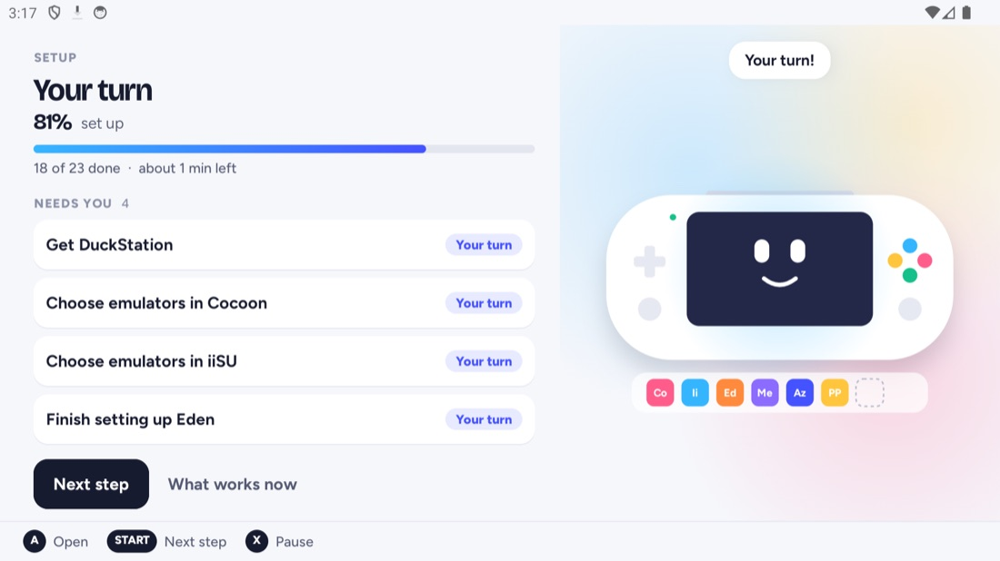
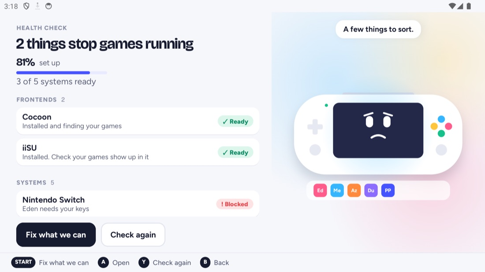
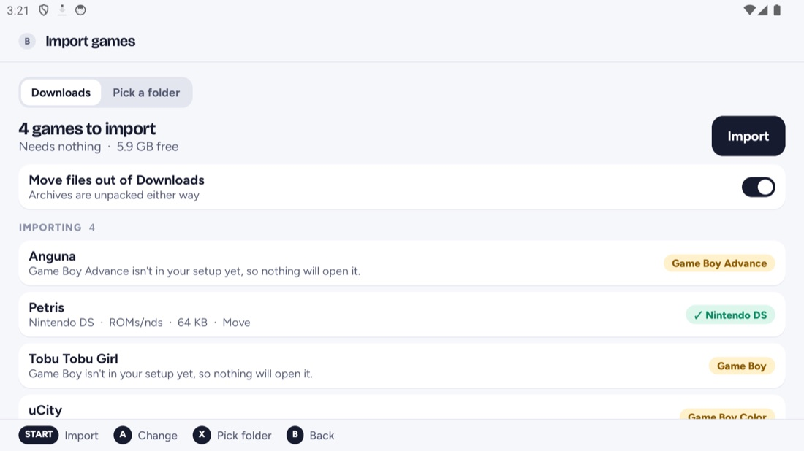
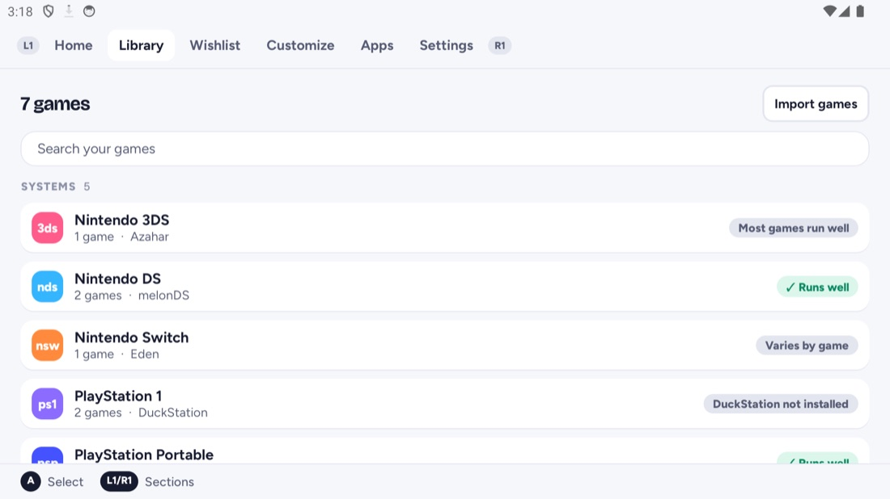

# RamROM Emu Manager

**Sets up an Android handheld for emulation, and keeps it working.**

Pick your frontends and the systems you play. RamROM Emu Manager then:
- installs the emulators that suit your device;
- makes the game folders and points every frontend at them;
- checks your BIOS files and keys;
- sorts new games into the right place.

Android won't let an app do some steps for you, like picking a folder inside another app. For
those, a small step card floats over the other app and tells you what to do. When the step is
done, you're brought back to RamROM.

Built for the AYN Thor first. Works on any Android 13+ handheld or phone, and the whole app can be
driven with a controller.

<p>
  
  
</p>

> **Your games stay yours.** This app works with games, BIOS files and keys you already own. It
> never provides them, links to them, or suggests where to get them. Issues asking for them are
> closed.

**Contents:** [What it does](#what-it-does) · [What it supports](#what-it-supports) ·
[Install](#install) · [First run](#first-run) · [Elevated vs Limited access](#elevated-vs-limited-access) ·
[Privacy](#privacy) · [Troubleshooting](#troubleshooting) · [Build it yourself](#build-it-yourself) ·
[Contributing](#contributing) · [Licence](#licence)

## What it does

- **Plan.** Choose any number of frontends and the systems you play.
  - The app recommends one emulator per system for your device's chip, and you can change any of them.
  - You can make a plan on one device, export it as an `.emuplan` file, and open it on another.
- **Set up.** Installs the emulators and frontends from their official sources. It also:
  - creates `ROMs/<system>` folders;
  - grants the permissions each app needs;
  - writes ES-DE's emulator choices;
  - applies tested device defaults to emulator settings.

  Steps run in parallel, and keep going if you leave the screen.
- **Guided steps.** Some things only you can do, like picking a folder inside another app. A step
  card floats over that app and shows the exact value to use. When the app sees the step is done,
  it brings you back by itself.
- **Health.** A setup percentage, plus a list of anything that stops games running:
  - a missing emulator, BIOS file or key;
  - a frontend pointed at the wrong folder;
  - missing folder access.

  Each problem comes with a fix. "Fix what we can" handles the ones that don't need you.
- **Import.** Sorts game files from Downloads, or any folder, into the right system folder. It also:
  - unpacks zip, 7z and RAR archives;
  - groups multi-disc games;
  - leaves out BIOS files and add-ons, and says why.
- **Already set up?** "I already have a setup" looks at what's on the device without changing
  anything. It then offers to fix only what's off. Every change the app makes is listed in
  *Settings › Change history*.

<p>
  
  
</p>

Coming later: a wishlist, and themes and game art for ES-DE.

## What it supports

**Frontends:** ES-DE, Cocoon, iiSU and RetroHrai!, or no frontend at all.

**Systems and their default emulators.** These are the defaults on a recognised chip, and you can
pick an alternative for any system:

| System | Emulator |
|---|---|
| Switch | Eden (or Citron) |
| 3DS | Azahar |
| DS | melonDS |
| PS1 | DuckStation |
| PS2 | NetherSX2 |
| PSP | PPSSPP |
| PS Vita | Vita3K |
| GameCube, Wii | Dolphin |
| Wii U | Cemu (community Android port) |
| NES, SNES, N64, Game Boy family, Genesis, Master System, Game Gear, Saturn, Dreamcast, Arcade, Neo Geo | RetroArch |
| Steam, PC | GameNative, Winlator |

**How apps get installed:**
- **Automatically**, from the developer's own GitHub or Forgejo releases: Eden, Citron, Azahar,
  melonDS, Vita3K, Cemu, GameNative, Winlator, Cocoon and iiSU.
- **Through the official page:** the app opens the download page for RetroArch, DuckStation,
  PPSSPP and Dolphin, and the Play Store for RetroHrai!.
- **You get it yourself:** ES-DE (paid) and NetherSX2. The app never downloads, hosts or links these.

**Devices:**
- **Verified:** the AYN Thor.
- **Recognised, with settings marked as best guesses:** AYN Odin 2, AYN Odin 3, Retroid Pocket 5,
  Retroid Pocket 6, Retroid Pocket Mini V2 and AYANEO Pocket DS.
- **Any other device:** gets picks for its chip family.

**Requires:** Android 13 or newer.

## Install

The app isn't on the Play Store. Download it from this repository:

- **[Releases](../../releases):** download the latest `RamROM-Emu-Manager-<version>.apk` and open
  it. The first time, Android asks you to allow installs from your browser or file manager.
- **[Obtainium](https://github.com/ImranR98/Obtainium)** (recommended, because it gets you updates):
  1. Tap *Add app*.
  2. Paste this repository's URL.
  3. Set *Filter APKs by regular expression* to `RamROM-Emu-Manager-.*\.apk`.

Every release is signed with the same key, so each update installs over the previous version.

A build you make yourself is signed with a different key, so it can't install over a release, and
a release can't install over it. Uninstall one before installing the other.

## First run

1. **Say which handheld this is.** It's usually detected. If it isn't, pick the closest model or
   "Another Snapdragon handheld".
2. **Choose what to do.** You can set up from scratch, adopt the setup you already have, plan for
   another device, or open a plan file.
3. **Pick your frontends and systems.** The app shows the emulator it picked for each system, and
   you can change any of them.
4. **Connect Shizuku** (optional, recommended).
   - The app installs Shizuku and walks you through pairing it over Wireless debugging.
   - It takes about a minute, and Wi-Fi has to be on.
   - You can skip it and run in Limited mode instead.
5. **Run setup.** Most steps run on their own. When something needs you, the app tells you what to
   do and opens the right screen.
6. **Add your games.** Either copy them into `ROMs/<system>`, or put them in Downloads and use
   *Library › Import games*.
7. **Add your BIOS files.** Put them in any folder, such as `BIOS/`. Health finds them by their
   checksum and copies them to where each emulator looks.
8. **Open Health** any time to see what's ready and fix the rest.

## Elevated vs Limited access

| | Elevated (Shizuku) | Limited |
|---|---|---|
| Installing apps | Without prompts | Android asks you to confirm each one |
| Permissions for other apps | Set for you | Guided: the app opens the right toggle |
| Emulator settings in `Android/data` | Written for you, with the emulator closed first | Shown as "Set these yourself", with exact values |
| Folders, Import, BIOS check, Health | Yes | Yes |

[Shizuku](https://shizuku.rikka.app/) gives the app the same access adb has, with no root needed.

Shizuku stops when the device restarts. To reconnect it, go to *Settings › Access*. That only needs
Wireless debugging on, which in turn needs Wi-Fi.

If you switch modes in the middle of a setup run, your progress is kept.

## Privacy

- No account, no analytics and no ads.
- The app only goes online to look up and download app releases from their official sources:
  GitHub, Forgejo and the developers' own sites.
- Your game list never leaves the device.
- *Settings › Report a problem* saves a text file, and you can read it before sending it to anyone.
  It holds the app version, device model, your plan and the Health findings, and leaves out game
  file names.

## Troubleshooting

**Shizuku won't connect.**
1. Turn on Developer options: tap *Build number* 7 times in *About phone*.
2. Turn on *Wireless debugging*. It needs Wi-Fi on, but it doesn't need internet.
3. After a restart, open *Settings › Access › Reconnect*.

**A frontend doesn't show my games.** Open Health. If a frontend is pointed at the wrong folder or
can't read it, Health lists the fix. Cocoon and iiSU also need you to confirm the folder or the
systems in their own settings, and Health names the exact setting.

**Switch games won't boot.** Eden and Citron need your own `prod.keys` and firmware. Until those are
in place, Health says the emulator needs your keys.

**The step card covers something.** Drag it anywhere. Tap its title to fold it into a small handle.

**Installs keep asking me to confirm.** That's Limited mode. Connect Shizuku under *Settings ›
Access* to install without prompts.

**Something else.** Open an [issue](../../issues) and attach the report from *Settings › Report a
problem*.

## Build it yourself

**You need:**
- **JDK 17 or newer** (tested with 21). Android Studio ships one.
- **The Android SDK, with platform 34.** Android Studio Koala (2024.1) or newer installs it for you.
- **Git, and internet for the first build.** Gradle fetches dependencies from Google, Maven Central
  and JitPack.

```sh
git clone <this repository's URL>
cd ramrom-emu-manager
./gradlew assembleDebug      # Windows: gradlew.bat assembleDebug
```

The first build takes a few minutes. The APK ends up at `app/build/outputs/apk/debug/app-debug.apk`.

To install it on a device that has USB debugging on:

```sh
./gradlew installDebug
```

**With Android Studio:** choose *File › Open* and pick the cloned folder. Wait for the Gradle sync
to finish, then press Run.

**On the command line, without Android Studio:** tell Gradle where the SDK is. Either run
`export ANDROID_HOME=/path/to/Android/sdk`, or create a `local.properties` file at the repository
root:

```properties
sdk.dir=/path/to/Android/sdk
```

**If the build fails:**
- *SDK location not found*: Gradle doesn't know where the SDK is. Do the step above.
- *The Android Gradle plugin requires Java 17*: point `JAVA_HOME` at a newer JDK.

**Tests:** `./gradlew test` runs the unit tests, with no device needed. They cover:
- the plan compiler and setup runner;
- the health checker and import planner;
- the knowledge file;
- the access layer.

**Release builds** are signed only when `keystore.properties` exists at the repository root. Without
it, `assembleRelease` makes an unsigned APK. The file is git-ignored, as are `*.jks` and
`*.keystore`. See [RELEASING.md](RELEASING.md).

```properties
storeFile=/absolute/path/to/release.jks
storePassword=...
keyAlias=...
keyPassword=...
```

### How the code is laid out

| Module | What's in it |
|---|---|
| `app` | Screens, navigation, running setup on a real device, import, the step card, Shizuku install |
| `core:engine` | Plan compiler, setup runner, health checker, setup score, import planner, library (plain Kotlin, unit tested) |
| `core:knowledge` | `bundle-v1.json`: devices, chips, emulators, frontends, systems, BIOS, device defaults, guided steps |
| `core:access` | Shizuku and Limited access behind one interface |
| `core:data` | Room database (change history), diagnostics export |
| `core:ui` | Theme, components, controller-friendly layouts |
| `core:entitlements` | Free vs unlocked features |
| `tools` | `build_title_index.py`, which builds the offline game title index from Wikidata and titledb |

Most of what the app knows about emulators lives in the knowledge file, not in code:
`core/knowledge/src/main/assets/knowledge/bundle-v1.json`. Adding a device, fixing an emulator's
package name or folder, or adding a BIOS checksum usually only means changing that file.

## Contributing

Bug reports, device reports and pull requests are welcome. Please read
[CONTRIBUTING.md](CONTRIBUTING.md) first. It covers:
- testing on an emulator;
- the knowledge file;
- the rules this project doesn't bend: no links to games, BIOS or keys, and no decryption code.

## Licence

RamROM Emu Manager is free software, released under the GNU General Public License version 3 or
later ([LICENSE](LICENSE)). An extra permission allows linking 7-Zip, whose RAR code carries the
unRAR restriction ([LICENSE-EXCEPTION](LICENSE-EXCEPTION)).

Third-party software and its licences are listed in the app under *Settings › About › Open-source
licences*.

RamROM Emu Manager isn't affiliated with any emulator, frontend or device maker. All trademarks
belong to their owners.
